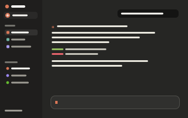

# Herdr — Claude desktop look

Makes the [Herdr](https://herdr.dev) desktop app look like the Claude desktop app (claude.ai's
chat UI, Code section included): warm off-black or ivory surfaces, ivory/ink text, clay accents,
and status colors from the same palette. The same palette ships for
[oh-my-pi](https://github.com/can1357/oh-my-pi) in
[omp-claude-theme](https://github.com/Tim-van-Oudheusden/omp-claude-theme), so an omp session
inside Herdr matches its frame.

| `claude-code` | `claude-desktop` |
|---|---|
|  |  |

## What's here

| File | What it is |
|---|---|
| `themes/claude-desktop-dark.json` | Dark palette: `#1f1e1d` frame, `#262624` cards, `#faf9f5` text, `#d97757` clay |
| `themes/claude-desktop-light.json` | Light palette: `#f5f4ed` frame, `#faf9f5` cards, `#141413` text, `#c6613f` clay |
| `themes/claude-code-dark.json`, `themes/claude-code-light.json` | The same palettes under their old names, removed in the next release |
| `layouts/claude-code.json` | Herdr's `main` layout with both themes (follows system light/dark), no sidebar divider line (a faint grey one on hover and while dragging), no lines under the tab bar or over the status bar, 12px cards with clean rounded corners, a subtler focus border, and unfocused splits faded slightly |
| `layouts/claude-desktop.json` | One conversation at a time, as in the Claude desktop app: a New chat row on top of the sidebar, the shown tab filling the rest of the window, no tab bar, status bar or card border |
| `layouts/*.svg` | The layouts' pictures for Settings → Look |
| `mods/claude-chrome/` | Herdr's `workspace-chrome` sidebar header and footer, plus the New chat row (used by `claude-desktop`) |
| `mods/claude-tabs/`, `mods/claude-status/` | Herdr's `tabs` and `workspace-status` bars without their separator lines (used by both layouts) |
| `mods/claude-pane/` | Herdr's `pane` header with its top corners rounded to the card's, so no square corner shows behind the card border (used by both layouts) |
| `install.sh` | Copies the files above into the Herdr app home |

Agent status colors: **working** is clay, **blocked** is Claude's violet, **done** is its
success green.

### Which layout

**claude-code** is for heavy multi-pane work: tabs, splits, the Files/Changes panels and the
status bar. **claude-desktop** works like the Claude app: one conversation fills the window and
you switch from the sidebar, where Spaces are Claude's projects and Agents its recents (clicking
an agent shows its tab). `ctrl-shift-l` cycles between layouts.

In `claude-desktop`:

- **New chat** opens the same menu as the tab bar's `+`: a terminal or any installed agent, in
  the shown space. Its key is Herdr's `ctrl-shift-t` (`tab.new`), which opens a terminal tab
  in the shown space without the menu.
- Splits still work; panes then get a border, and their header shows on hover.
- The hidden bars come back with `herdr-app do layout.toggle --id tabs` (or `--id status`).
- The sidebar's top row drags the window and, on Linux and Windows, holds the window buttons the
  hidden tab bar used to draw.

## Install

```sh
./install.sh --switch   # copy into ~/.config/herdr-app and switch the window to the layout
```

`./install.sh` copies without switching; `./install.sh --uninstall` removes the files.
`HERDR_APP_HOME` picks another Herdr home. Back to the stock layout: `ctrl-shift-l`, or
Settings → Look → Herdr.

### Themes only, on your current layout

After installing, pick **claude desktop dark** / **claude desktop light** in Settings → Look →
Theme, or set them in `~/.config/herdr-app/settings.json` (used wherever a layout sets no theme):

```json
{ "theme": { "light": "claude-desktop-light", "dark": "claude-desktop-dark" } }
```

The themes used to be called `claude-code-dark` / `claude-code-light`. Those names still install
for this release and then go away; switch a `settings.json` that names them to the new ones.

## Type

Claude's chat sets regular-weight text with generous leading; Herdr's defaults (Medium weight,
line height 1) read denser and heavier. Both layouts set:

| Field | Value | Why |
|---|---|---|
| `font_weight` | `400` | Regular body text, the biggest single difference from Herdr's 500 |
| `font_weight_bold` | `600` | Semibold emphasis, as Claude's headings and `**strong**` are |
| `terminal_line_height` | `1.2` | Airier rows; box-drawing characters still join |
| `terminal_padding` | `[16, 20]`; `[20, 28]` in `claude-desktop` | Horizontal room so prose doesn't touch the card edge; more where there's no card |
| `ui_font` | `Geist` | Claude's own faces can't ship; Geist is bundled with Herdr, set explicitly so a change in Herdr's default doesn't change the layout |

These win over the same fields in `settings.json` while a layout shows, so the layouts'
`ui_font` replaces a personal one there. The terminal face (`font`) stays yours. For a softer one:

```json
{ "font": "Geist Mono", "font_ligatures": false }
```

## Where the colors come from

- Surfaces and text: claude.ai's `--bg-*` / `--text-*` tokens (dark `bg-200` frame, `bg-100`
  cards, `bg-000` popovers; light `bg-200` frame, `bg-100` cards).
- Clay `#d97757` (`--accent-brand`); `#c6613f` (`--brand-000`) in light for contrast.
- Status colors: **working** clay `#d97757` (`--accent-brand`); **blocked** violet `#9b87f5` /
  `#5645a1` (`--accent-pro-*`); **done** green `#65bb30` / `#2f7613` (`--success-*`). The same
  values are omp-claude-theme's `violet` and `green`.
- Terminal ANSI colors: built from the same token families (danger, success, warning, accent,
  pro violet, mineral) and checked for contrast against the card background.
